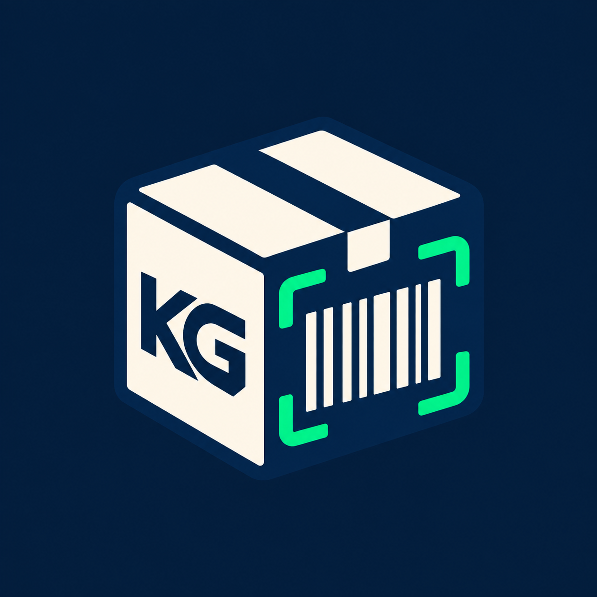

# KG Consol

<p align="center">
  
</p>

<p align="center">
  Android warehouse app for organizing batches, scanning orders,
  and printing labels on Zebra printers.
</p>

<p align="center">
  
  
  
</p>

# English

## Features

- Create `KG…` batches and boxes with automatic or manually entered IDs.
- See live order and box totals for every batch on the home screen.
- Scan common 1D and 2D barcodes with ML Kit.
- Store the complete decoded barcode value without reformatting it.
- Use OCR as a fallback for printed order numbers such as `01-2345-6789/1`.
- Enter legacy order numbers manually.
- Prevent duplicate orders across the same batch.
- Print two ZPL labels over TCP/IP to a Zebra printer.
- Copy or share a complete batch report through the Android share menu.
- Use the app in Russian, English, or Spanish.

## Workflow

1. Create a batch.
2. Select an automatic or manual ID for its first box.
3. Scan the order barcodes.
4. Tap **Complete Box & Print** to complete the box and print its labels.
5. The app automatically opens the next box so scanning can continue.

When the final batch report is opened, boxes with no orders are deleted from the
database and excluded from the exported report.

## Barcode scanning

The complete value returned by the barcode scanner is stored as the order number.
For example:

```text
[CDK] 123456789
```

is stored exactly as shown, without extracting the digits or changing its format.

If no barcode is detected, the app uses ML Kit Text Recognition to find a printed
legacy order number. 1D barcode scanning can be enabled or disabled in Settings.

## Technology

| Component | Technology |
|---|---|
| Language | Kotlin 2.0 |
| UI | Jetpack Compose + Material 3 |
| Architecture | MVVM |
| Local database | Room |
| Preferences | DataStore |
| Dependency injection | Hilt |
| Camera | CameraX |
| Barcode and OCR | Google ML Kit |
| Navigation | Navigation Compose |
| Printing | ZPL over TCP, port 9100 |

## Requirements

- Android 8.0 / API 26 or newer;
- Android Studio with JDK 17;
- Android SDK 35;
- a Zebra printer available on the local network for label printing.

## Build

The repository does not currently include Gradle Wrapper scripts. Open it in
Android Studio, run Gradle Sync, and select **Build → Build APK(s)**.

With a compatible local Gradle 8.13 installation:

```bash
gradle :app:assembleDebug
```

The debug APK is generated at:

```text
app/build/outputs/apk/debug/app-debug.apk
```

## Printer configuration

| Setting | Default |
|---|---|
| IP address | `192.168.1.168` |
| Port | `9100` |
| Label size | 150 × 100 mm |
| Copies | 2 |

The printer address and port can be changed in **Settings**, which also provides
a test-print action.

## Project structure

```text
app/src/main/java/com/kgconsol/
├── data/          Room, DataStore, and repository
├── domain/        models and validation rules
├── presentation/  Compose screens and ViewModels
├── di/            Hilt providers
└── util/          ZPL printing
```

## Android permissions

- `CAMERA` — barcode and text scanning;
- `FLASHLIGHT` — camera torch;
- `INTERNET` and `ACCESS_NETWORK_STATE` — network printing;
- `WAKE_LOCK` — keeping the screen awake during warehouse work.

## Version

Current version: **1.4.9** (`versionCode 11`).

Additional technical documentation is available in
[KGConsol_README.md](KGConsol_README.md).

## Author

Vyacheslav Fitlin — [@Slavafit](https://t.me/Slavafit)

---

# Русский

## Возможности

- создание партий `KG…` и коробок с автоматическими или ручными номерами;
- отображение общего количества заказов и коробок в каждой партии;
- сканирование линейных и двумерных штрихкодов через ML Kit;
- сохранение полного содержимого штрихкода без изменения формата;
- резервное OCR-распознавание номеров вида `01-2345-6789/1`;
- ручной ввод заказа;
- защита от повторного добавления заказа в одну партию;
- печать двух ZPL-этикеток через TCP/IP на принтере Zebra;
- отчёт по партии с копированием и отправкой через системное меню;
- русский, английский и испанский интерфейсы.

## Рабочий процесс

1. Создайте новую партию.
2. Выберите автоматический или ручной номер первой коробки.
3. Отсканируйте штрихкоды заказов.
4. Нажмите **Complete Box & Print** для завершения коробки и печати этикеток.
5. Приложение автоматически откроет следующую коробку для продолжения работы.

При открытии итогового отчёта коробки без заказов удаляются из базы и не
включаются в выгрузку.

## Сканирование

Для настоящего штрихкода сохраняется вся строка, возвращённая сканером.
Например, значение:

```text
[CDK] 123456789
```

будет записано без извлечения цифр или другого преобразования.

Если штрихкод не найден, приложение пробует распознать напечатанный номер заказа
с помощью ML Kit Text Recognition. Распознавание обычных 1D-кодов можно включить
или отключить в настройках.

## Технологии

| Компонент | Технология |
|---|---|
| Язык | Kotlin 2.0 |
| UI | Jetpack Compose + Material 3 |
| Архитектура | MVVM |
| Локальная база | Room |
| Настройки | DataStore Preferences |
| DI | Hilt |
| Камера | CameraX |
| Штрихкоды и OCR | Google ML Kit |
| Навигация | Navigation Compose |
| Печать | ZPL через TCP, порт 9100 |

## Требования

- Android 8.0 / API 26 или новее;
- Android Studio с JDK 17;
- Android SDK 35;
- принтер Zebra, доступный в локальной сети, — для печати этикеток.

## Сборка

В проекте пока нет Gradle Wrapper. Откройте проект в Android Studio, выполните
Gradle Sync и соберите APK через **Build → Build APK(s)**.

При наличии локального Gradle 8.13:

```bash
gradle :app:assembleDebug
```

Готовый debug APK появится здесь:

```text
app/build/outputs/apk/debug/app-debug.apk
```

## Настройка принтера

По умолчанию используются:

| Параметр | Значение |
|---|---|
| IP-адрес | `192.168.1.168` |
| Порт | `9100` |
| Размер этикетки | 150 × 100 мм |
| Количество копий | 2 |

IP-адрес и порт можно изменить на экране **Settings**. Там же доступна тестовая
печать.

## Структура проекта

```text
app/src/main/java/com/kgconsol/
├── data/          Room, DataStore и репозиторий
├── domain/        модели и правила валидации
├── presentation/  Compose-экраны и ViewModel
├── di/            зависимости Hilt
└── util/          печать ZPL
```

## Разрешения Android

- `CAMERA` — сканирование;
- `FLASHLIGHT` — фонарик камеры;
- `INTERNET` и `ACCESS_NETWORK_STATE` — печать по локальной сети;
- `WAKE_LOCK` — запрет выключения экрана во время работы.

## Версия

Текущая версия: **1.4.9** (`versionCode 11`).

Подробное техническое описание находится в
[KGConsol_README.md](KGConsol_README.md).

## Автор

Вячеслав Фитлин — [@Slavafit](https://t.me/Slavafit)
